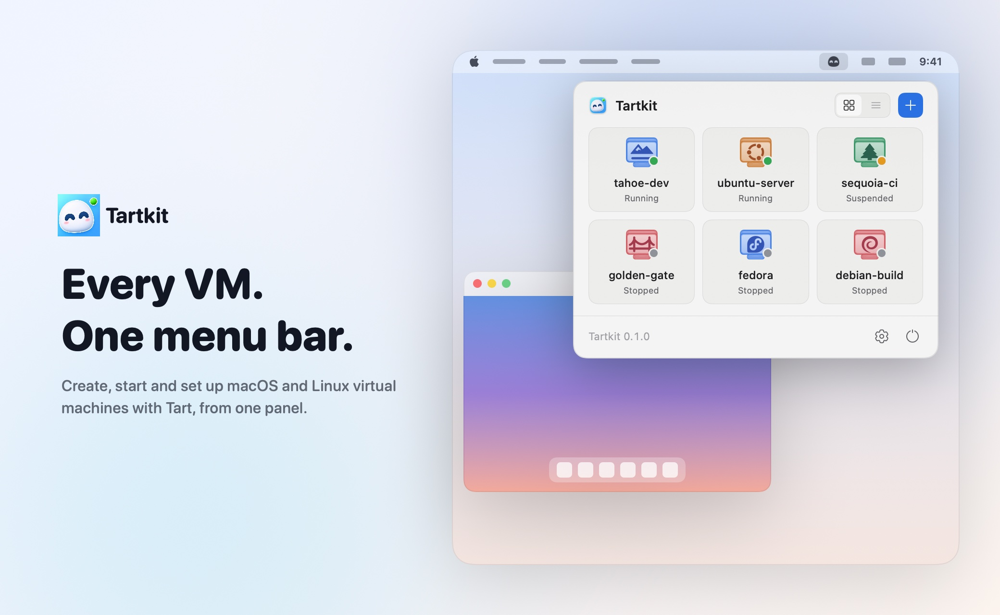

# Tartkit

### Every VM. One menu bar.

**macOS and Linux virtual machines on your Mac, created and run from one panel.** 
Tartkit is a menu bar app for [Tart](https://tart.run/). 
Pick a system, press start, and change settings in a window instead of on the command line.

   

**[Download](https://github.com/Seaony/Tartkit/releases/latest)** &nbsp;·&nbsp; **English** · [简体中文](README.zh-CN.md)

 

<picture>
  <source media="(prefers-color-scheme: dark)" srcset="docs/assets/product-dark-en.jpg">
  
</picture>

 

## Is Tartkit for you?

Tart runs macOS and Linux virtual machines on Apple silicon, but every task is a command: which image to clone, which flags to pass to `tart run`, how to share a folder, how to bridge the network. If you don't use it every day, you end up looking those up again.

Tartkit puts the same machines in a menu bar panel:

- **See every machine at once**: each one is a card with its system icon and state. Switch between cards and a compact list.
- **Start a new machine in a few clicks**: choose macOS or Linux, name it, set CPU and memory, and Tartkit runs the clone or install for you.
- **Change settings in a window**: CPU, memory, display, network, shared folders, disks and devices, each explained where it isn't obvious.
- **Keep using Tart**: Tartkit calls the `tart` you already have and works with the machines already in Tart's storage. Nothing is converted.

It's for you if you run local VMs for testing, CI or trying out a new macOS. If you script everything around `tart` already, you don't need it.

> [!NOTE]
> Tartkit is early. It needs Tart installed (`brew install cirruslabs/cli/tart`); if Tart isn't in a usual place, set its path in **Settings › General**.

## Quick start

**1 · Install.** Download the DMG from the **[latest release](https://github.com/Seaony/Tartkit/releases/latest)**, open it and drag `Tartkit.app` into Applications.

Tartkit runs on Apple silicon Macs with macOS 26 or later. It updates itself from GitHub Releases through Sparkle.

**2 · Create a machine.** Click the Tartkit icon in the menu bar and press **+**. Search or pick a system, then fill in the name and hardware. Systems that need a newer Mac than yours are greyed out.

**3 · Use it.** Click a card to start the machine, or to bring a running one's window to the front. Right-click for the rest: suspend, stop, connect over SSH or Screen Sharing, settings, delete. The menu only shows what makes sense for the machine's current state.

## Supported systems

<table>
<tr><td><b>Ready-made macOS</b></td><td>macOS 27 Golden Gate · macOS 26 Tahoe · macOS 15 Sequoia · macOS 14 Sonoma</td></tr>
<tr><td><b>Fresh macOS install</b></td><td>Apple's restore images, the latest version, an IPSW download URL or a local IPSW file</td></tr>
<tr><td><b>Linux</b></td><td>Ubuntu 24.04 · Ubuntu 22.04 · Debian · Fedora · a blank disk for any ARM64 installer ISO</td></tr>
<tr><td><b>Custom image</b></td><td>Clone any Tart image from an OCI registry</td></tr>
</table>

Ready-made images come from Cirrus Labs' public registry. Fresh macOS installs download Apple's restore image and take longer.

## What it does

### A panel, not another window

Tartkit lives in the menu bar with no Dock icon. Every machine shows its system icon with a status dot: green when running, orange when suspended, grey when stopped. The menu bar icon changes while machines are running.

### Settings with explanations

Each machine has one set of settings, saved with the machine: hardware, display, boot mode, network, sharing, disks and devices. Options that aren't obvious, like the four network modes, suspend support or Rosetta, say what they do and what they need. Use **Start with Temporary Settings…** to try a change for one launch without saving it.

### Beyond start and stop

Take and restore snapshots before risky changes. Export and import `.tvm` archives, and pull and push images through an OCI registry. See what the image cache is using and choose where Tart keeps its machines. Each launch writes its own log you can open from the management window.

### Built for macOS

Native SwiftUI and AppKit. Light and dark appearance. English and Simplified Chinese. Launch at login and in-app updates.

## Privacy

- Machine settings live in `~/Library/Application Support/Tartkit/profiles.json`. First-boot passwords you choose to save go into your login Keychain, not the file.
- Logs are kept in `~/Library/Logs/Tartkit/`.
- Tartkit has no analytics. Besides running `tart` on your Mac, it talks only to the registries and download links you choose, to ipsw.me for the list of macOS restore images, and to Tartkit's GitHub Releases feed for updates.

## Acknowledgements

Tartkit runs every machine through [Tart](https://tart.run/) by Cirrus Labs, and the ready-made images come from [Cirrus Labs](https://github.com/cirruslabs). Interface icons are [Solar](https://www.figma.com/community/file/1166831539721848736) by 480 Design. Updates use [Sparkle](https://sparkle-project.org/). See [docs/THIRD_PARTY_NOTICES.md](docs/THIRD_PARTY_NOTICES.md) for the full list.

---

  Your virtual machines, one click from the menu bar.

