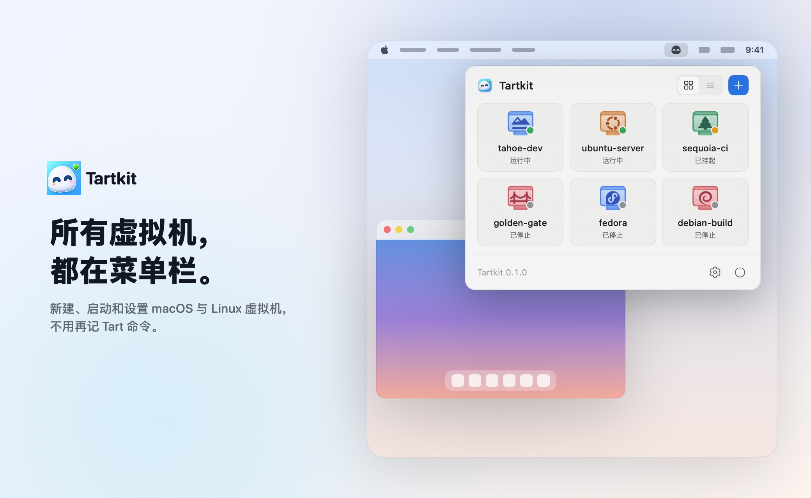

# Tartkit

### 所有虚拟机，都在菜单栏。

**Mac 上的 macOS 和 Linux 虚拟机，在一个面板里新建和运行。** 
Tartkit 是 [Tart](https://tart.run/) 的菜单栏 App。 
选好系统，点一下启动；改设置在窗口里点选，不用再查命令行参数。

   

**[下载](https://github.com/Seaony/Tartkit/releases/latest)** &nbsp;·&nbsp; [English](README.md) · **简体中文**

 

<picture>
  <source media="(prefers-color-scheme: dark)" srcset="docs/assets/product-dark-zh.jpg">
  
</picture>

 

## Tartkit 适合你吗？

Tart 能在 Apple 芯片的 Mac 上跑 macOS 和 Linux 虚拟机，但每件事都要敲一条命令：克隆哪个镜像、`tart run` 带哪些参数、怎么共享文件夹、怎么桥接网络。不是天天用的话，每次都得重新查一遍。

Tartkit 把这些虚拟机放进菜单栏的一个面板：

- **一眼看全**：每台虚拟机是一张卡片，带系统图标和状态；也可以切换成紧凑的列表。
- **点几下就有一台新的**：选 macOS 或 Linux，起个名字，设好 CPU 和内存，克隆或安装由 Tartkit 替你跑。
- **在窗口里改设置**：CPU、内存、画面、网络、共享目录、磁盘和外设，不好懂的选项旁边都有说明。
- **还是原来的 Tart**：Tartkit 调用你已经装好的 `tart`，直接管理 Tart 存储目录里已有的虚拟机，不做任何转换。

如果你要在本机跑虚拟机做测试、跑 CI，或者想先试试新版 macOS，它适合你。如果你已经用脚本把 `tart` 包好了，就不需要它。

> [!NOTE]
> Tartkit 还在早期。它需要先装好 Tart（`brew install cirruslabs/cli/tart`）；Tart 不在常见位置时，到 **设置 › 通用** 里指定路径。

## 快速开始

**1 · 安装。** 从 **[最新版本](https://github.com/Seaony/Tartkit/releases/latest)** 下载 DMG，打开后把 `Tartkit.app` 拖进“应用程序”。

Tartkit 只支持 Apple 芯片的 Mac，需要 macOS 26 或更高版本。它通过 Sparkle 从 GitHub Releases 自动更新。

**2 · 新建虚拟机。** 点菜单栏的 Tartkit 图标，按 **+**。搜索或直接点选系统，再填名字和硬件。本机系统太旧、跑不了的版本会显示成灰色。

**3 · 开始使用。** 点卡片启动虚拟机；已经在运行的，会把它的窗口调到最前。其他操作在右键菜单里：挂起、停止、用 SSH 或屏幕共享连接、设置、删除。菜单只显示虚拟机当前状态下能用的操作。

## 支持的系统

<table>
<tr><td><b>预装 macOS</b></td><td>macOS 27 Golden Gate · macOS 26 Tahoe · macOS 15 Sequoia · macOS 14 Sonoma</td></tr>
<tr><td><b>全新安装 macOS</b></td><td>Apple 官方恢复镜像、最新版本、IPSW 下载地址或本地 IPSW 文件</td></tr>
<tr><td><b>Linux</b></td><td>Ubuntu 24.04 · Ubuntu 22.04 · Debian · Fedora · 空白磁盘（配合任意 ARM64 安装 ISO）</td></tr>
<tr><td><b>自定义镜像</b></td><td>从 OCI 镜像仓库克隆任意 Tart 镜像</td></tr>
</table>

预装镜像来自 Cirrus Labs 的公开镜像仓库。全新安装 macOS 要先下载 Apple 的恢复镜像，花的时间更长。

## 功能

### 一个面板，不是又一个窗口

Tartkit 常驻菜单栏，不占 Dock。每台虚拟机显示系统图标和状态点：运行中是绿色，已挂起是橙色，已停止是灰色。有虚拟机在运行时，菜单栏图标会跟着变化。

### 设置都有说明

每台虚拟机一份设置，跟着虚拟机保存：硬件、画面、启动方式、网络、共享、磁盘和设备。不好懂的选项，比如四种网络模式、允许挂起、Rosetta，都写了它做什么、需要什么。想临时试一个改动，用 **用临时设置启动…**，只对这一次启动生效，不会保存。

### 不只是开和关

改动前拍快照，出问题再恢复。导出和导入 `.tvm` 归档，通过 OCI 镜像仓库拉取和推送镜像。能看到镜像缓存占了多少空间，也能选择 Tart 把虚拟机存在哪里。每次启动都有单独的日志，在管理窗口里就能打开。

### 为 macOS 而做

原生 SwiftUI 和 AppKit。支持浅色和深色外观，支持简体中文和英文。可以开机启动，可以在应用内更新。

## 隐私

- 虚拟机设置保存在 `~/Library/Application Support/Tartkit/profiles.json`。你选择保存的首次启动密码存进登录钥匙串，不写进这个文件。
- 日志在 `~/Library/Logs/Tartkit/`。
- Tartkit 不做任何统计。除了在本机运行 `tart`，它只访问你选的镜像仓库和下载地址、用来获取 macOS 恢复镜像列表的 ipsw.me，以及检查更新用的 Tartkit GitHub Releases。

## 致谢

Tartkit 通过 Cirrus Labs 的 [Tart](https://tart.run/) 运行每一台虚拟机，预装镜像来自 [Cirrus Labs](https://github.com/cirruslabs)。界面图标使用 480 Design 的 [Solar](https://www.figma.com/community/file/1166831539721848736)。自动更新使用 [Sparkle](https://sparkle-project.org/)。完整清单见 [docs/THIRD_PARTY_NOTICES.md](docs/THIRD_PARTY_NOTICES.md)。

---

  你的虚拟机，都只差菜单栏上的一次点击。

